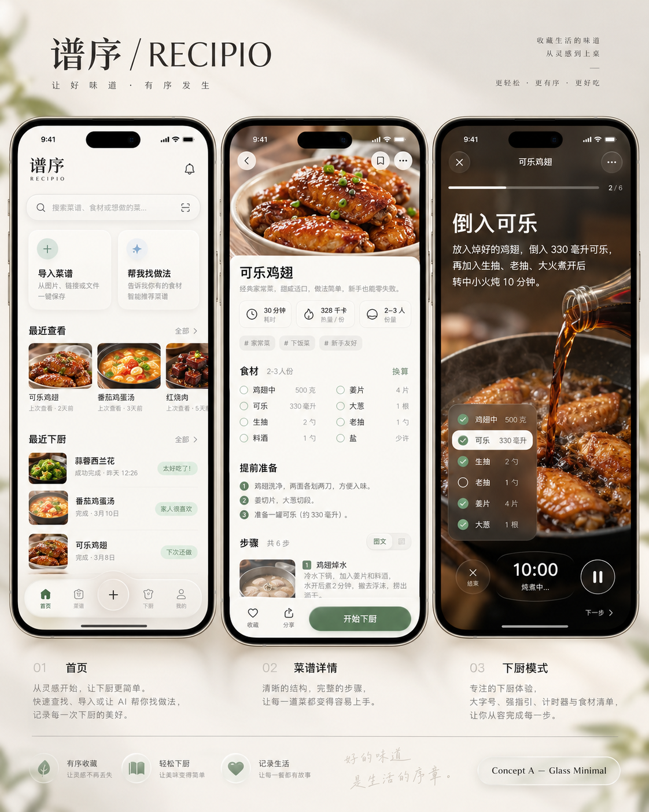

# 谱序 RECIPIO｜UI V2 产品界面规格书

## Glass Minimal · Concept A

文档编号：RECIPIO-UIV2-SPEC-001\
规格版本：1.0 · 2026-10-23\
适用平台：现有 Android APK；React / TypeScript / Vite / Tailwind / shadcn / Capacitor\
状态：视觉方向已由用户选定；本文件为实施交接规格，不代表界面已实现或通过真机验收。

**设计目标**：保留用户选中概念图的暖白、鼠尾草绿、轻玻璃控制层、细腻图片与清晰排版，把现有谱序打磨成精致、克制、可信的个人菜谱工具。不是复制 iOS 外壳，也不是重做产品。

**核心原则**：内容是主体，玻璃是控制层；每个按钮都有真实行为，每个异常都有恢复路径。

**执行边界**：不重新设计 Logo，不恢复视频实验，不新增收藏、计时器、推荐、购物清单、云账号或业务数据结构。

**交付关系**：本规格是设计与验收依据；配套《Codex 执行提示词》规定阶段、授权与停止点。两者必须一起阅读。

**首次执行停止点**：先完成现有能力映射、设计系统和首页／详情／烹饪三屏的隔离交互样板，提交视觉评审。获得认可后再接入生产流程、覆盖其余页面。

<!-- PAGEBREAK -->
# 01｜文档控制与已核对基线

## 1.1 事实、设计决定与待验证项

| 标记 | 含义 | 本文使用方式 |
| --- | --- | --- |
| 已确认 | 用户明确选择或仓库已存在 | Concept A；原 Logo；现有数据与安全边界 |
| 设计规定 | 为落地所作的具体设计决定 | 数值 Token、布局、文案、组件外观；在首轮视觉评审中校准 |
| 待实测 | 需要运行或设备证据 | 玻璃性能、字号放大、键盘、TalkBack、OEM 行为 |
| 不在本轮 | 未授权新增的业务能力 | 收藏、计时、推荐、视频、五个业务 Tab |

## 1.2 仓库核对快照

2026-10-23 通过 GitHub 只读核对，稳定 `main` 为：

`649804a8209413f9d682f1079a4fd19ea84cd064`

文件树：`2d1993bcab8dbb59c540b8225d51259562ad0316`。当前稳定版本口径为 `v0.9.1-logo-refresh`；后续执行必须重新 fetch，不能假设远端永远不变。[R1]

`package.json` 确认本地界面为 React / TypeScript / Vite，使用 Tailwind、shadcn 与 Capacitor；仓库同时保留旧 Next.js 路径，但不能因此把本轮改造导向旧 Web/云架构。**本轮不迁移 Kotlin Compose 或 SwiftUI。**[R2]

SQLite v4、Preview v7、Backup Format v2、现有 RecipeLibrary 契约保持不变。本文只读核对了关键产品与界面文件，不等同整仓代码审计或运行验收。[R3–R5]

## 1.3 冲突裁定

当前用户明确决定 ＞ 已冻结产品语义 ＞ 本文具体设计规则 ＞ 概念图中的装饰、示例数据和未批准控件。新的明确授权可以改变产品范围；单纯选中视觉图不能推定每个生成控件都获批。

本规格替代此前口头草案中的错误技术栈和越界建议：不做 Compose 重写，不把五栏导航、收藏、计时器、份量换算等直接带入生产。

<!-- PAGEBREAK -->
# 02｜唯一视觉母版与还原方式

图 1：用户明确选中的视觉母版。手机框、系统状态栏、海报标题、装饰植物和图片内示例内容不是产品素材或功能授权。

保留：暖白实体内容、柔和绿色、圆润但有层级的几何、轻玻璃导航、紧凑功能入口、照片与正文的清楚关系，以及深色专注烹饪氛围。

不照搬：五项底栏、通知铃铛、收藏、分类标签、份量换算、倒计时、视频占位、虚构评分、最近浏览追踪。具体映射见第 03 章。

母版 SHA-256：`44c053738390829a7c805512600a026136089da445abaa1a26f45a033e0d05f4`。仅用于识别参考附件，不用它替代可交互 UI，也不从展板裁切菜品照片作为生产数据。

<!-- PAGEBREAK -->
# 03｜视觉还原与产品范围对照

| 概念图元素 | UI V2 的正式处理 |
| --- | --- |
| 暖白／绿色／轻玻璃 | 保留；具体数值以第 05–07 章为准 |
| 顶部品牌 | 使用已批准卷页 Logo；不换琴形、字标或 Launcher 图标 |
| 最近查看 | 改为“最近加入”；仍按创建时间倒序，不新增浏览追踪 |
| 最近下厨 | 本轮不新增全库记录聚合；保留卡片“上次做过”和详情中的真实记录 |
| 五栏底部导航 | 保留首页／菜谱／设置三个目的地；新增按钮不是第四个 Tab |
| 收藏／通知／分类 | 不展示无实现控件，不恢复这些产品模块 |
| 换算／计时／步骤勾选 | 不新增数值换算、倒计时和步骤完成记录；只保留查看与切换 |
| 沉浸式做菜 | 复用 Focus / Guided；仅明确“完成这道菜”创建做过记录 |
| 食材浮层 | 可新增只读食材查看 Sheet；不新增勾选进度或持久状态 |
| 主图与步骤图 | 只显示实际本地图片；无图必须有完整设计，不伪造图片 |
| AI 标签 | 保留“来源明确／AI 推断／缺失待确认”，不改业务语义 |
| 视频占位 | 删除；视频方向已暂停，不出现入口或“即将上线” |

最近下厨的全库时间线需要目前接口没有提供的查询；不能扫描当前分页后假称是全库最近记录。若后续要恢复该视觉模块，须单独批准读取接口与排序口径。[R4–R5]

本轮覆盖现有所有用户界面，包括编辑、历史、设置、备份、分享待处理、错误与不确定保存；不是只替换三张首页截图。

<!-- PAGEBREAK -->
# 04｜信息架构与页面职责

| 层级 | 页面 ID | 页面职责 |
| --- | --- | --- |
| 根页面 | P01 首页 | 本地搜索、添加／找做法入口、最近加入 |
| 根页面 | P02 菜谱 | 全库列表、既有耗时筛选、分页 |
| 根页面 | P12 设置 | 数据备份恢复、AI 密钥、版本信息 |
| 内容页 | P03 详情 | 完整食材、准备、事项、步骤与记录入口 |
| 全屏查看 | P04 Focus / Guided | 只查看步骤；最后可明确完成 |
| 编辑页 | P05 新建／编辑 | 复用普通 Recipe 编辑器 |
| 导入流程 | P06 AI 输入、P07 审核 | 文字／图片输入、人工检查与保存 |
| 导入流程 | P08 网页导入 | Parser-first，AI 仅显式触发 |
| 查找流程 | P09 找做法 | 输入、候选、选定来源提取、审核 |
| 记录页 | P10 完成／历史、P11 修改历史 | 可选完成附加信息与只读历史 |
| 系统覆盖层 | O01–O05 | 新增、更多、放弃／危险确认、删除撤销；分享与核查见状态页 |

底栏只有“首页／菜谱／设置”，图标分别使用同一线性图标族的 Home、BookOpen、Settings。三个根页面显示底栏；详情、编辑、导入、Finder、全屏步骤页隐藏，避免任务中误切换。

新增入口位于首页／菜谱右上角。点开 O01 后可选“手动录入”“文字／截图整理”“从网页链接导入”“帮我找做法”。每一行进入已有流程，不自动联网。

浏览返回必须恢复原搜索词、耗时筛选、分页位置与滚动锚点；无条件重置为首页顶端不合格。弹层只允许一个活动焦点域，不堆多层 Sheet。

<!-- PAGEBREAK -->
# 05｜色彩 Token 与可读性

以下为实施初值；视觉评审可微调，但不能降低对比度。主体为暖白，不转成黄纸纹理、纯冷白或大面积渐变。

| Token | 色值 | 用途 |
| --- | --- | --- |
| `canvas` | `#F6F4EF` | 主背景 |
| `surface` | `#FBFAF7` | 实体卡片、表单、Sheet 主体 |
| `surface-muted` | `#F0ECE5` | 弱分区、无图占位 |
| `text-primary` | `#1B1B1D` | 标题、正文 |
| `text-secondary` | `#6E6A65` | 说明与辅助文本 |
| `text-caption` | `#716D65` | 小字号、占位文字 |
| `accent-action` | `#49684F` | 主按钮／选中图标／链接 |
| `accent-pressed` | `#3C5742` | 主操作按下 |
| `accent-sage` | `#7F9B82` | 装饰色，不配普通白色小字 |
| `accent-soft` | `#E6EFE5` | 轻选中背景 |
| `border-subtle` | `#DEDAD3` | 非必要分隔线 |
| `border-control` | `#858A82` | 必须可识别的输入／选择边界 |
| `warning-ink` | `#815A23` | 警告文字，配 `#F7EEDD` |
| `error-ink` | `#A2433D` | 错误／危险操作，配 `#F8E9E7` |
| `cook-solid` | `#202420` | 专注模式固定深底 |

计算校核：白字在 `accent-action` 上约 **6.22:1**；主文字／主背景约 **15.65:1**；辅助文字／主背景约 **4.88:1**。原浅绿配白字仅约 **3.04:1**，不用于普通字号主按钮。

普通文字要求 ≥4.5:1；必要控件边界和状态图形 ≥3:1。动态玻璃仍须按实际合成背景检查，色值表通过不等于整个 App 无障碍通过。[R7–R8]

<!-- PAGEBREAK -->
# 06｜尺寸、字体与布局

本项目主要界面单位是 **CSS px / rem**，不是原生 dp/sp。字号用 rem，根字号基准 16px；设备缩放效果必须真机测，不能机械把 dp 改名为 px。

| 类别 | 规定 |
| --- | --- |
| 字体 | 本机 system-ui 与中文系统回退；不下载 Apple 字体、不复制 SF Symbols 字体 |
| 页面标题 | 28px / 36px 行高 / 600；首页品牌 24/32/600 |
| 详情标题 | 30/40/600；长标题自然换行，不压缩字号 |
| 小节标题 | 20/28/600；次小节 18/26/600 |
| 正文 | 16/26/400；步骤正文 20/32/400 |
| 辅助／标签 | 14/22/400；Caption 12/18，不承载关键风险信息 |
| 按钮 | 16/24/600；主按钮最小高 52，次按钮最小高 48 |
| 触控 | 所有可操作目标至少 48×48；可见图标 20–24，不扩大图形填满目标 |
| 页面边距 | 360–599 宽为 20；320–359 宽为 16；≥600 宽为 24 |
| 间距级别 | 4／8／12／16／20／24／32；小节之间 28–32 |
| 圆角 | 标签 10，缩略图 14，输入／按钮 18，卡片 24，Sheet 28，胶囊 999 |
| 嵌套圆角 | 默认内圆角 = 外圆角 − 内边距，最小 6；照片边缘光学修正须记录 |
| 内容宽度 | 单列正文最大 680；外壳最大 960；大屏不简单拉长文本 |

390×844 CSS 视口是主要评审尺寸，不是唯一适配目标。不把手机外框、刘海、状态栏时间画进 App。

按钮高度均为最小值；200% 字号允许增高和换行。金额／用量／时长不能因固定行高被截断。横向滚动只允许最近加入条带与耗时筛选，不允许整页水平溢出。

<!-- PAGEBREAK -->
# 07｜玻璃、层级与动效

Apple 的玻璃材质指导强调导航与控制层的分离；谱序借鉴这一原则，但在 Android WebView 中实现自己的轻玻璃，不宣称使用原生 Apple Liquid Glass。[R6]

| 材质 | 初始参数与位置 |
| --- | --- |
| Glass Light | `rgba(251,250,247,.88)`；backdrop blur 20px、saturate 110%；用于底栏／顶栏 |
| Glass Dark | `rgba(32,36,32,.90)`；blur 16px；用于烹饪控制条 |
| Solid Fallback | 对应实体色、不透明、无模糊；功能与布局完全一致 |
| Surface | 菜谱、输入、审核、设置主体保持实体；不做整页透明 |
| Shadow Float | `0 8px 24px rgba(27,27,29,.08)`；只给浮层与底栏 |
| Border Glass | 白色 .55 的 1px 高光可装饰；不能作为唯一可识别边界 |

同屏大面积 backdrop-filter 层不超过 2；弹出 Sheet 时背景底栏停止模糊。不要给每张卡片加模糊，也不要使用 WebGL 折射、持续追光、全屏噪点或永久动画。`@supports` 不支持时使用实体回退；减少透明的系统信号只有实测可用才接入，不能声称跨设备普遍支持。[R9]

| 动效 | 时长／行为 |
| --- | --- |
| 按下 | 120ms；明度变化，最多 scale .98；禁用时无缩放 |
| 根 Tab 切换 | 160ms 淡入，不做左右页面推进幻觉 |
| 内容页进退 | 220ms，位移不超过 12px＋透明变化；保持返回语义 |
| Sheet | 240ms 进入／180ms 退出；不强弹跳 |
| 状态反馈 | 160ms；不移动主按钮、不闪烁正文 |

统一 easing：`cubic-bezier(.2,.8,.2,1)`。`prefers-reduced-motion: reduce` 下取消非必要缩放／位移／平滑滚动，保留明确的静态状态反馈。[R10] 不新增触觉插件；当前无可靠 haptic 能力时采用纯视觉反馈。

<!-- PAGEBREAK -->
# 08｜按钮组件与所有状态

| ID／类型 | 尺寸与样式 | 允许用途 |
| --- | --- | --- |
| C01 Primary | 高≥52、r18、深鼠尾草绿＋白字、左右20 | 保存、开始整理、开始寻找、进入引导 |
| C02 Secondary | 高≥48、r18、实体浅底＋中性文字／必要边界 | 返回候选、继续编辑、取消可取消请求 |
| C03 Text | 触区≥48、无底、绿色或中性字 | 查看全部、编辑、展开说明 |
| C04 Icon | 48×48，图标22，圆形实体／玻璃底 | 返回、关闭、更多、新增 |
| C05 Destructive | 高≥48，危险色文字；最终危险确认可实底 | 删除、放弃本轮、确认替换恢复 |
| C06 Select | 高≥48、选中淡绿底＋深绿文字／标记 | 耗时筛选、既有评价选项 |

**默认**：一块任务区域最多一个视觉主按钮。次要操作不与主按钮同色抢主次。不会把“添加”和“保存”混用同一文案。

**按下／悬停**：触屏不依赖 hover；支持鼠标时只轻调背景。长按不作为任何功能的唯一入口。

**焦点**：2px 深绿外环，offset 2px；不使用 outline:none。图标按钮必须有中文可访问名称。

**禁用**：禁用点击与键盘提交，保留清楚文案；附近显示原因，例如“请先确认推断和缺失内容”。不能只用灰色让用户猜。

**处理中**：按钮宽度保持，spinner 16＋“正在保存…”等真实阶段文字；立即防重入。保存按钮不转成可取消按钮。网络请求只有既有服务支持取消时才显示“取消”。

**失败**：主按钮恢复可重试状态，输入保留；不自动重复付费请求。**成功**：执行既有导航／清理，最多一个低干扰确认反馈。

C04 返回是离开当前页面；关闭是关当前弹层。危险确认不能把“确认”放在默认焦点；先聚焦安全选择。

<!-- PAGEBREAK -->
# 09｜输入、选择、标签与进度

| 组件 | 视觉／布局 | 行为与异常 |
| --- | --- | --- |
| C07 本地搜索 | 高≥52、r18；左搜索、右清空；持久名称“搜索我的菜谱” | 搜菜名／食材；输入与清空只读本地，不自动 Finder |
| C08 单行输入 | 高≥52、r18；标签在外，错误在下 | 聚焦2px环；输入不跳位；错误关联字段，不仅红边 |
| C09 多行输入 | 高≥120，可纵向增高；16/26 | 保留换行；字符计数读取现有限制；超限不截断 |
| C10 筛选组 | 单行可横滚；可见胶囊高36、触区48 | 全部／≤30分／30–60分／>60分；沿用既有不重叠边界 |
| C11 状态标签 | 高≥28、r10；图标＋文字 | 来源明确／AI推断／缺失待确认；不是可点击筛选，除非有真实动作 |
| C12 勾选确认 | 24px视觉框＋整行≥48触区 | 仅用于既有审核同意等真实状态；不伪造食材完成状态 |
| C13 进度 | 细线4px＋文字“第2步／共6步” | 步骤进度可确定；联网过程不得虚构百分比 |

所有 Placeholder 只是示例，不能替代持久标签。清空搜索后焦点留在搜索框；去别页回来恢复查询。键盘“搜索”键不自动调用付费搜索；Finder 仍需明确“开始寻找”。

数量、份量、热量和准备时长遵守现有模型：空值不是 0，“适量”不变成克数，“一会儿”不变成分钟。未知总耗时仅在“全部”筛选显示。

模型错误沿用安全错误码；缺密钥、无网络、无可靠来源、结构校验失败要区分，不能全部显示“请重试”。

<!-- PAGEBREAK -->
# 10｜内容组件、图片与真实数据

| ID | 组件规范 |
| --- | --- |
| C14 功能入口卡 | 两列、gap12、r24、padding16、高度随文字；图标背景32、标题17/24、说明14/22；整卡是单一 button |
| C15 最近加入卡 | 宽约152（窄屏136）、图片4:3、r18；标题最多2行、时间与准备提示；横向不自动滚动 |
| C16 菜谱列表行 | 图72×72，间距12，行padding12，最小高96；标题2行＋真实耗时；整行可打开 |
| C17 元信息组 | 耗时／份量／每份约热量，以弱分隔表达；窄屏与大字号换行，不缩字 |
| C18 步骤块 | 序号24＋正文；配图4:3或按原图比例；相关关键事项放正文下方 |
| C19 提醒块 | 图标＋短标题＋说明；警告用浅暖底，错误用浅红底；不使用彩虹卡片 |

首页照片只来自本地封面；步骤照片只来自步骤真实引用。无图显示统一浅实体底与小尺寸 BookOpen／Image 轮廓，不生成随机美食封面，不联网补图。封面 `object-fit:cover`；步骤证据图可 `contain`，不得裁掉字幕／关键动作。

破损图片回退为“图片暂不可用”，保留文字和编辑入口；只有数据层确知不存在才写“已删除”。查看原图进入本地大图预览，关闭恢复焦点；不增加远程加载。

标题在列表可截两行，但详情必须全文。用量与单位不能用省略号隐藏；长食材名和用量在窄屏改上下排。稀疏菜谱（只有菜名）仍是正常菜谱，不标“草稿”“完成度低”或催完善。

演示图片只能存在隔离样板／测试夹具；不得混入用户正式库。设计样板中的菜名、耗时与评价必须标记为演示数据，不制造真实使用统计。

<!-- PAGEBREAK -->
# 11｜Sheet、Dialog、Toast 与返回

| ID | 容器与尺寸 | 退出与焦点规则 |
| --- | --- | --- |
| O01 新增 Sheet | 底部r28，实体内容＋轻玻璃标题；四行操作各≥64 | 背景不可操作；关闭回到触发按钮；行点选只导航 |
| O02 更多菜单 | 锚定更多按钮；编辑／做过记录／修改记录／删除 | 不放无实现的收藏或对外菜谱分享 |
| O03 放弃确认 | 最大宽360；继续编辑／放弃本轮 | 点击遮罩＝继续编辑；返回先关确认；默认安全项 |
| O04 危险确认 | 明确对象与后果；恢复替换为独立确认页 | 不能用轻Toast承载；不滑动误确认 |
| O05 删除撤销 | 屏幕底栏上方，操作区可达 | 严格沿用5秒窗口；不重新计时、不延长业务期限 |

Sheet 主体最大高度为可用视觉视口的85%，内部只有一个滚动容器；键盘出现后按实际 viewport 收缩，不能被键盘压住底部动作。底部安全区只计算一次。

系统返回优先级：系统输入法 → 顶层菜单／Sheet → 放弃确认 → 当前页 → 根页系统行为。不得用任意延迟或第二套猜测性键盘状态机吞返回键。

网络请求中返回必须走既有取消与 generation 失效机制；不能只隐藏加载框而继续把迟到结果写回。保存／恢复不确定时禁止直接丢弃，显示“核查保存结果”或“核查恢复结果”。

Dialog 使用现有可访问基础组件，不手写无焦点陷阱的 div 弹层。进入时聚焦标题或安全动作，关闭后回到来源；TalkBack 不能读到遮罩下的活动控件。

<!-- PAGEBREAK -->
# 12｜P01 首页与 P02 菜谱库

## 首页默认态

从上到下：品牌行 → 本地搜索 → 两张入口卡 → 最近加入条带 → 菜谱列表简览 → 浮动玻璃底栏。品牌只在首页完整出现，其他页面使用页面标题，避免每页重复大 Logo。

390宽下：左右20；品牌行56；搜索52；入口卡gap12；最近加入显示约2张完整卡＋下一张的一部分；底栏左右16、内容高64、底部12＋安全区。所有高度为起始参考，放大字号自动增高。

入口卡文案固定为“添加菜谱／文字、截图或链接”和“帮我找做法／比较有来源的做法”。添加卡打开O01；Finder卡进入输入页，均不联网。右上角“＋”同样打开O01，不做中央假Tab。

最近加入按现有创建时间倒序；编辑不改变排序。列表中的上次做过使用真实 `lastCookedAt`，没有记录不显示。不要伪造“最近查看”“全网热门”或“家人很喜欢”。

## 搜索与空态

有查询时，入口卡与最近加入让位于垂直搜索结果，查询固定可见；结果为0显示“还没有找到这道菜”，次操作“帮我找『查询词』的做法”。点它只进入 Finder 并预填，仍需再次点“开始寻找”。

空库显示一条清晰说明和“添加第一道菜”，另有轻入口“帮我找做法”；不植入样例菜谱。加载只出现必要骨架，无循环推荐动画。

## 菜谱库

标题“我的菜谱”＋新增；搜索与四种既有耗时筛选；默认 C16 列表，不增加新的持久视图设置。分页／加载更多保持现有接口，不在UI自行全库抓取。返回恢复筛选、查询与滚动位置。

<!-- PAGEBREAK -->
# 13｜P03 菜谱详情

有封面：顶部4:3照片、返回／更多浮动按钮；照片下实体内容板r24，仅允许12px轻叠压。无封面：直接显示标题和内容，不保留空白大图，不把默认美食图当成用户图片。

正文顺序：菜名 → 轻元信息 → 食材 → 提前准备 → 关键事项 → 完整步骤 → 备注 → 做过概览／历史入口。准备与事项必须在开始查看步骤前可发现；目录按钮只能滚到锚点，不能默认把完整步骤藏进Tab。

食材使用单列，名称左／用量右；宽度不足时用量落下一行。份量只读，不提供换算。总耗时未知写“耗时未填写”；热量有值显示“约 ×× kcal／份”，份数未知不计算总热量。

底部操作条：次按钮“编辑”，主按钮“开始烹饪”；更多菜单保留“记录做过”“查看修改记录”“删除菜谱”等真实入口。无步骤时主按钮改为“补充做法”进入原编辑器，仍保留“完成这道菜”的既有显式记录入口。

每步右侧“单步查看”打开 Focus；“开始烹饪”打开 Guided，不写做过记录。查看完最后一步也不能自动完成；必须明确点击“完成这道菜”。

删除走既有保护与5秒撤销；没有新增长期回收站。点击大图只预览；点更多不触发卡片导航。固定底部条不能挡住最后一行文字，滚动末尾必须预留其实际高度。

不显示分类、收藏、作者、点赞、推荐、视频播放或虚假难度。餐食长描述仅显示已有备注，不让AI自动补品牌文案。

<!-- PAGEBREAK -->
# 14｜P04 单步查看与引导烹饪

采用母版右屏的深色沉浸氛围，但不让关键文字直接压在复杂照片上。外层固定 `cook-solid`；有步骤图时在中下方显示真实图片，顶部标题／正文保留稳定深底。底部只有轻玻璃控制条。

顶部：关闭48×48、菜名最多2行、只读进度“第2步／共6步”。当前步骤标题可用“步骤 2”，不得凭空生成语义标题。正文20/32，长内容独立滚动，底部操作固定但不遮挡。

| 控件 | 行为 |
| --- | --- |
| 退出引导／返回完整步骤 | 关闭全屏，回详情原步骤位置；不记录做过 |
| 上一步 | 第一项禁用，其他项只改变查看索引 |
| 下一步 | 只改变查看索引，不写步骤完成记录 |
| 完成这道菜 | 仅Guided最后一步显示；沿用幂等完成动作，随后进入P10 |
| 食材 | 打开只读食材Sheet，显示真实名称与用量；关闭回当前步骤 |
| 步骤图 | 打开本地大图；没有图则正文自然扩展，不造图 |

不做倒计时、暂停计时、自动下一步、语音控制、屏幕常亮、通知提醒或视频占位。Focus 到最后一步不擅自显示完成按钮，保持当前模式语义。[R5]

本轮不新增左右滑动切步骤，避免与Android边缘返回及图片手势冲突；通过大按钮切换。任何后续手势都不能成为唯一操作途径。

完成保存忙时防重复点击；失败保留当前步骤和重试入口。明确离开不保存阅读进度，不把观看当完成。该页面深色是场景样式，不代表已实现全局暗色主题。

<!-- PAGEBREAK -->
# 15｜P05 手动新建与编辑

标题栏：“新建菜谱”或“编辑菜谱”；返回48、完成区不重复大品牌。内容按字段分组：菜名 → 封面 → 耗时／份量／每份热量 → 食材 → 提前准备 → 关键事项 → 步骤 → 备注。

菜名是唯一必填；只填菜名可直接保存普通菜谱。其他可选组默认显示清楚的“添加食材”“添加步骤”等入口，不制造草稿状态、完成度或强制填写。

重复行使用同一行组件：序号／字段／更多。主要编辑动作可见，移除放在行更多内；支持原有前移／后移，不强制拖拽。图片添加、替换、移除继续走现有本地媒体流程。正在保存时禁止改动本次写入快照。

底部：“取消”＋“保存菜谱／保存修改”。输入有效且发生必要改动才可提交；提交后沿用当前保存服务与返回目的地。无变化编辑不制造修改历史。

| 状态 | 明确行为 |
| --- | --- |
| 空菜名提交 | 保留所有输入，提示“请输入菜名”，聚焦菜名 |
| 未保存返回 | O03继续编辑／放弃修改；取消后仍留原字段 |
| 图片选择取消 | 保留原图和全部文字 |
| 某字段非法 | 就地说明，不清空整个表单、不静默修成0 |
| 保存失败 | 保留内容，允许已有安全重试 |
| 保存结果不确定 | 禁止新建第二份，进入既有核查路径 |

键盘可见时底部操作不悬空压住输入；视口变小可将动作变成可滚动页尾。首次系统Back只关闭键盘，下一次才询问放弃。200%字号时元信息从并排改为单列。

<!-- PAGEBREAK -->
# 16｜P06 AI 文字／截图输入

标题改为任务语言“整理菜谱”，副说明始终可见：“点击开始后，发送本轮文字和截图给 AI，可能产生费用。结果需你确认。”详细隐私说明可折叠，但费用与传输提醒不能藏起来。

顶部保留返回；正文包含带持久标签的文字框、当前图片缩略图列表、输入计数、主按钮“开始 AI 整理”。AI只是方法，不使用大量星光、霓虹、拟人头像或“智能魔法”装饰。

图片1–6张，默认两列缩略图，完整预览可查看；单图有前移／后移／移除，交互触区48。排序与原始来源照片只是临时输入，不用作封面。所有数量、格式、大小限制读取已有AI Contract，不另造UI常量。

| 状态 | 布局与动作 |
| --- | --- |
| 空输入 | 主按钮禁用，说明“输入文字或添加截图” |
| 缺密钥 | 显示“前往设置”；保留输入，配置后回本轮 |
| 图片处理中 | 图片区状态＋不可重复添加；不全屏遮盖原文字 |
| 请求中 | 真实状态“正在整理…”＋明确取消；无伪百分比 |
| 失败 | 具体安全原因＋“重试整理”；不自动重试、不删输入 |
| 放弃 | O03；调用既有取消与临时清理，不只清前端数组 |

原生密钥框继续由 Native 安全输入，不改成React表单。后台切换不等于放弃；进程死亡的原有限制不伪装为已恢复。外部分享到达时遵守第22章，不覆盖输入。

<!-- PAGEBREAK -->
# 17｜P07 AI 审核、预览与保存

页面标题“检查整理结果”。顶部短摘要显示“来源明确 X · 推断 Y · 待确认 Z”，状态以图标＋文字区分；普通用户界面不直接展示 explicit/inferred/missing 英文值。

默认展开推断／缺失检查项；来源明确可折叠。点“定位内容”滚到对应字段并短暂高亮，不自动修改。主编辑器复用P05的字段与图片行为，不重建第二套Recipe编辑语义。

没有来源封面时不出现大图占位；不能因设计图好看而自动下载或生成封面。字段的“来源明确”表示来源标注，不等于事实已独立验证。用户手改字段不擅自将原AI状态升级成来源明确。

底部顺序：必须的检查确认行 → 保存动作。存在推断／缺失时，保持原完整文案：

**“我已检查以上 AI 推断和缺失内容”**

未勾选时按钮禁用并显示原因；Service 门禁必须保留。没有不确定项不强迫额外勾选。用户编辑、勾选后才能保存，不能用滑动、离开页面或键盘回车隐式确认。

| 情况 | 交互处理 |
| --- | --- |
| 同名 | 提示“已有同名菜谱”；可改名或明确仍保存，不自动覆盖 |
| 返回继续编辑 | 保持本轮结果；回输入并重做分析前清楚提示会替换当前草稿 |
| 保存中 | 输入只读、防重入；不能手动放弃未知写入 |
| 保存不确定 | “核查保存结果”；不直接再创建 |
| 保存成功 | 打开普通菜谱详情，释放既有来源与临时会话 |

正文的Review、保存核查和清理逻辑均由现有AI服务承担；UI重构不修改Qwen请求、Schema、模型或密钥路由。

<!-- PAGEBREAK -->
# 18｜P08 网页链接导入

标题“从网页导入”。URL标签固定“网页链接”，示例只用标准公开网址形式；底部主按钮“读取网页”。提示“先读取网页，不会自动调用 AI”，不承诺万能平台解析。

| 页面状态 | 用户可见内容 | 允许操作 |
| --- | --- | --- |
| 输入 | URL输入、短说明 | 读取、返回 |
| 读取中 | 正在读取网页＋取消 | 走既有取消 |
| 完整Parser结果 | “已从网页读取”＋普通可编辑预览 | 检查保存，无AI复选框 |
| 部分结果 | “网页信息不完整”＋已有内容 | 直接补充／使用AI继续整理 |
| 多个接近候选 | 菜名、食材数、步骤数 | 用户选一个，不混合 |
| 正文可读但无结构 | 简短说明 | 主动AI整理／手动录入 |
| 无法读取 | 网络／受限／安全拒绝等对应文案 | 重试、文字／截图、手动 |

“使用AI继续整理”附近保留联网与费用提醒；点击前不请求Qwen。输入非法、安全拒绝和超时不能统一成“格式不对”；不向用户展示Java栈或完整URL token。

Parser预览不出现“AI推断”；真正进入AI后才使用P07审核。取消／返回沿用当前 source 生命周期、generation 和不确定保存保护。

该页不加内置浏览器，不修改DNS／SSRF／重定向规则，不为视频恢复解析器。URL、正文与网页图片仍不长期保存，所有入口说明与实际能力一致。

<!-- PAGEBREAK -->
# 19｜P09 帮我找做法

输入页：标题“帮我找做法”；菜名必填；偏好可选；主按钮“开始寻找”。说明缩成两句：“联网寻找公开做法，可能产生费用。选中后再整理，保存前由你确认。”保留详细说明入口。

菜名与偏好分别沿用120／500 Unicode code points限制；计数不占据标题层级。键盘完成不自动付费提交，点击主按钮才执行Search。

候选页：最多3张纵向实体卡，不做推荐信息流。每张：菜名、来源域名、短特点、最多3条已有差异、确有证据的耗时／准备提示、次主按钮“按这个做法整理”。无证据留空，不填“未知难度评分”或“全网最佳”。

不要为了对比表漂亮新增难度、风格、适合人群等没有数据契约的字段。来源完整URL保留在现有临时状态，展示只用host；不要只按同域匹配来源。[R3–R4]

| 状态 | 规定 |
| --- | --- |
| 搜索中 | 保留查询，显示取消；不显示伪造搜索进度 |
| 只有1个候选 | 正常显示，不补假卡片 |
| 没有候选 | 清晰空态，可改条件／文字截图／网页导入 |
| 提取中 | 锁定选中来源，取消回当前候选，不重新搜索 |
| 结构交接失败 | “整理结果未通过校验”；保留输入，不要求反复付费尝试 |
| 预览成功 | 进入P07复用审核与保存；不自动写库 |

保留当前已修复的 Responses function handoff、结构化搜索来源成员校验、选定来源Extractor匹配；视觉修改不触碰Provider合同。

<!-- PAGEBREAK -->
# 20｜P10 完成记录与 P11 修改历史

## 完成后的附加信息

仅在用户明确完成动作已成功写入最小做过记录后进入P10。顶部“已记录这次下厨”，下方“照片、评价和备注都可跳过”。不要庆祝动画、积分、连续打卡或再次强迫确认完成。

评价只有“好吃／一般／下次调整”三个既有值，以C06表达单选，不变成星级。照片属于本次记录；只有明确“设为菜谱封面”才影响封面。底部“完成”只退出附加信息，不再次创建做过记录。

可提供“调整这道菜”进入既有编辑器。用户跳过或返回保留已创建的最小记录，不将可选项失败误判为整次记录不存在。

## 单菜谱做过历史

标题“做菜记录”，显示真实次数与上次时间。条目包含日期、可选照片、评价、备注；按既有时间倒序游标分页。没有照片／评价不出现空卡片。删除单记录不删菜谱，不误删共享图片。

## 修改历史

标题“修改记录”，按时间显示字段旧值→新值。默认展开最近一条，其余可折叠；长步骤原文可展开，不能仅用红绿颜色表达差异。图片变化显示前后缩略图或缺图说明。

历史只读：不出现“回滚”“设为当前版本”“分支版本”。无实际变化不得写噪音记录；UI不重算历史、修改时间或配方。

空态分别为“还没有做过记录”和“还没有修改记录”，不要使用“暂无数据”统称。所有时间以设备本地化显示，具体时间可查看，不伪造“最近看过”。

<!-- PAGEBREAK -->
# 21｜P12 设置与数据安全界面

设置采用实体分组列表，每行≥60，高度随辅助文字扩展。标题“设置”，不显示登录头像、会员、消息或账号。

分组：数据与备份 → AI → 关于。仅展示真实已有功能；本轮全局主题以浅色为主，不新增无效暗色开关。深色烹饪页属于场景样式。

| 功能 | 文案与交互 |
| --- | --- |
| 导出备份 | “导出完整备份”；进入现有SAF，不重复导出旧包 |
| 从备份恢复 | 明示会替换当前数据；先校验、预览，再明确确认 |
| 私有安全副本 | 只表述已有恢复保护，不宣称可防卸载／清数据 |
| AI密钥 | 已配置／未配置；设置／更换／删除仍走原生安全输入 |
| 版本信息 | 显示实际APK版本，不由UI硬编码一个更高版本 |

恢复确认不是普通轻弹层：显示将替换的数据范围和已有安全副本机制；“取消”与“确认替换恢复”明确区分，危险动作不得默认焦点。检查中、恢复中和结果不确定时禁止开始导入、Finder或覆盖导航。

备份／恢复取消遵守既有服务是否可取消的真实阶段，不能伪造“随时可取消”。不确定状态必须有核查路径，不能显示成功勾号。权限或SAF失败时保留明确恢复动作，不要求清数据。

密钥成功后回到原流程；私密内容不进入WebView、日志、截图、备份或交付包。系统权限弹窗维持平台外观，不伪装成玻璃自绘权限框。

<!-- PAGEBREAK -->
# 22｜外部分享、键盘与状态竞争

分享提示放在当前页面顶部控制区下方，不覆盖主要按钮，也不自动抢焦点。URL只显示hostname；文字不展示私人全文；图片仅显示数量。

| 当前状态 | 新分享到达 | 打开／关闭规则 |
| --- | --- | --- |
| 安全根页／只读详情 | 沿用已验收自动预填 | 仍不Fetch、不AI、不保存 |
| 手动编辑／完成附加项 | 待处理提示 | 当前文字与图片不变 |
| AI输入／审核／请求 | 待处理提示 | 不覆盖、不取消现有请求 |
| 网页已有输入／结果 | 待处理提示 | 不替换当前URL与Parser结果 |
| Finder任意活动流程 | 待处理提示 | 不切走候选或当前Review |
| 恢复／保存忙／不确定 | 禁止路由，暂存 | 只按原安全状态恢复处理 |
| 最新分享替代待处理 | 显示替代提示 | 仍调用已有Native release清理旧临时图 |

提示按钮：“打开”“忽略”；不安全时禁用打开并说明“请先完成当前操作”。原先延后的分享在回到安全页后仍由用户主动打开，不突然抢页面。

键盘处理复用现有Native返回链：首次Back只关闭IME，输入、图片、审核勾选、候选均不丢；再次Back按页面离开规则执行。Web样板不能证明真机IME通过。

任何异步页面切换都要使用当前owner/generation的真实状态；动画结束不是成功信号。旧组件卸载后的回调不能清空新页面或消费下一次分享。

<!-- PAGEBREAK -->
# 23｜空态、异常与无障碍

| 条件 | 用户看到什么 | 恢复动作 |
| --- | --- | --- |
| 本地库为空 | 尚未添加菜谱 | 添加第一道菜／找做法 |
| 本地无匹配 | 未找到自己的这道菜 | 清空筛选／主动找做法 |
| 断网 | 本地界面照常；仅联网流程给错误 | 手动重试，不切断编辑 |
| 缺密钥 | AI尚未配置 | 原生设置，回原流程 |
| 读取失败 | 具体安全短说明 | 重试／既有降级入口 |
| 保存不确定 | 结果尚未确认 | 核查结果，不重复新建 |
| 临时清理失败 | 有临时内容待清理 | 保留既有重试，不宣称已删除 |
| 图片缺失 | 图片暂不可用 | 保留文字，编辑图片 |

所有状态都用文字补充图标；成功／推断／缺失不得只靠绿黄红区分。可见标签与可访问名称一致，表单错误关联字段，`aria-live`不重复播报整个长页面。

键盘导航顺序按视觉阅读顺序；弹层聚焦受控、关闭返回来源。选择后读出选中状态。长文本、200%字号和TalkBack必须可使用，不为保持海报比例缩字号。

对比度按第05章检查；玻璃叠亮图、暗图、繁杂图都测。全屏步骤正文使用固定深色承托，不靠“智能对比度”口头保证。无障碍是验收目标，不在本规格阶段声称认证通过。[R7–R10]

<!-- PAGEBREAK -->
# 24｜响应式、性能与素材约束

320宽：边距16，元信息换行，食材必要时上下排；两张入口卡可改单列。360／390／412宽保持双入口、单列详情。≥600宽扩大外壳但正文最大680，列表可两列；首次实现不新增独立平板导航系统。

200%字号：卡片、按钮、Tab自动增高；Tab文本不挤没。长来源域名允许断行；整页无横向滚动。软键盘使用实际可用视口，保留输入和操作可达。横屏短高度Sheet可接近全屏，但不得二重滚动锁死。

图片懒加载，尺寸预留避免列表跳动；不在每次滚动解码原图。无远程字体、随机图源、分析SDK、持续动画；现有基础依赖不因样式更新而整批升级。

性能验收使用同一设备、同一数据集对比基线与V2：记录冷启动、首次可交互、连续滚动和打开Sheet。明显卡顿必须修复或降级玻璃；目标连续操作无可感知长冻结，同设备关键任务中位耗时不因样式增加超过20%时不阻断，否则记录并处理。数值是项目验收目标，不是已经达到的事实。

主内容不能用整张设计截图代替；照片、Logo之外的文字、按钮、输入和状态必须是可访问组件。保留已批准Logo文件；任何新图片仅用于测试，拥有明确来源和用途，不导入用户库。

视觉评审以实际内容区截图为准，不用漂亮手机框、植物、海报标题掩盖错误。暖白不能越改越黄，绿色不能荧光化，玻璃不能成为整页卡片材质。

<!-- PAGEBREAK -->
# 25｜工程映射与阶段授权

设计组件命名为拟新增建议；执行前核对实际路径，不能凭名称覆盖已有文件。

| 范围 | 主要现有路径／拟新增职责 |
| --- | --- |
| App外壳 | `src/native/library-app.tsx`；只拆展示职责，不重写状态流 |
| 原子视觉 | 拟建 `src/native/ui-v2/tokens.css`、`components/`；作用域限定native根 |
| 内容界面 | `recipe-detail.tsx`、`recipe-editor.tsx`、`step-viewer.tsx` |
| 记录界面 | `cooking-completion.tsx`、`cooking-history.tsx`、`recipe-change-history.tsx` |
| 导入／寻找 | `ai/`、`link-import/`、`find-recipe/` 的Screen／Preview展示层 |
| 受保护边界 | Repository、Schema、Backup、Provider、Native安全插件默认只读 |

**G0 核对**：读取AGENTS、基线、现有Screen与测试；写页面／动作／状态映射和偏差表。不从视频实验分支开发，不重新做需求访谈。

**G1 隔离样板**：建立Token与组件状态页；同一演示数据完成首页、详情、烹饪三屏及无图／长标题／200%状态。不连接私人数据库、不调用AI；截图与参考比较。停止在 `UI_V2_VISUAL_READY_FOR_REVIEW`，等待唯一一次中期视觉认可。

**G2 正式接入**：认可后接入现有库与安全路由，完成列表、编辑、记录；逐模块测试先行，不逐个普通Task询问。

**G3 业务页面统一**：AI／网页／Finder／分享／备份设置全部按本规格完成；不能借重构更改业务协议。

**G4 交付验收**：全量回归、浏览器视觉、Android真实IME／分享／覆盖安装、用户真机体验分层记录。仅缺设备证据时是待验收，不自动冻结、不合main。

<!-- PAGEBREAK -->
# 26｜可执行验收矩阵

| ID | 验收项 | 合格证据 |
| --- | --- | --- |
| V01 | 母版视觉特征 | 同数据三屏对照；暖白、绿色、层级、照片、玻璃使用明确匹配 |
| V02 | 无图／长内容 | 只有标题、无图、最长合法标题、长步骤截图无错位 |
| V03 | 按钮全状态 | 默认／按下／焦点／禁用／加载／错误六态对照 |
| V04 | 适配与对比 | 320／390／412／768宽、200%字号；颜色计算和玻璃实图检查 |
| B01 | 离线核心 | 冷启动、CRUD、图片、烹饪、历史正常；首页输入0网络 |
| B02 | 显式联网 | 添加／分享／本地搜索不触发Fetch或AI；按钮计数测试 |
| B03 | 审核与保存 | 推断／缺失未确认禁止保存；重复点击不重复写入；不确定可核查 |
| B04 | 烹饪语义 | 看步骤／下一步／退出不记做过；仅完成创建一次记录 |
| B05 | 键盘返回 | 真实IME首次Back只收键盘，第二次遵循页面保护 |
| B06 | 分享竞争 | 冷／热启动、dirty、AI请求、Finder、恢复、旧回调均不覆盖 |
| D01 | 数据不变 | SQLite4／Preview7／Backup2、媒体引用、Key边界与恢复契约不变 |
| D02 | 覆盖安装 | 原包名／签名、旧菜谱图片与历史保留；不清用户数据 |
| A01 | 可访问交互 | 48触区、可访问名、焦点返回、TalkBack关键主链 |
| P01 | 玻璃性能 | 同设备基线对比；必要时实体回退，功能不变 |

执行证据必须带：commit、设备／WebView版本、视口／字号、测试数据、实际结果、NOT_RUN。自动化、浏览器、模拟器、用户手机不能互相冒充。

业务回归使用当前仓库命令：`npm test`、`npm run test:apk`、`typecheck`、`lint`、`build:local`、`sync:android`；Android使用显式app任务与专属设备serial。先读现有脚本，不升级依赖来消除无关警告。

不复用历史测试数字；不自动调用真实Qwen。只有请求协议实际改变才需要另行申请真实调用验证，本轮默认0次。

<!-- PAGEBREAK -->
# 27｜Skills、交付与停止条件

## 已核实的设计技能来源

用户自有仓库为 `cc7279694-debug/HR-product-design-system`。完整设计内容在 `feat/initialize-product-design-system`，核对提交 `d3ca5d96ffd8d2fe795c4b771858756d4879fc53`；该仓库main目前只有简短README，不能只clone默认main就声称已取得完整技能。[R11]

真正的入口：`skills/hr-product-design-system/SKILL.md` 与 `skills/product-ui-ux-design/SKILL.md`。设计系统提取、Refinement、Production Specification、Developer Handoff、Production Validation是其Playbook章节／子路线，**不是五个已核实的独立安装Skill**。

读取整仓中的 `DESIGNER.md`、产品记录，以及 `playbooks/ui-ux/17`至`21`对应章节。旧产品记录若包含云账号、收藏等过期范围，以本次规格和稳定产品基线为准。不要只拷贝一个SKILL.md，不执行不明安装脚本，不全局覆盖已有技能。

Codex环境若已有 `superpowers`，用于计划、TDD、执行与验证；若已有 `build-web-apps`，使用其frontend构建、React最佳实践、shadcn与浏览器测试能力。不得因Skill鼓励创意就重开概念或修改Logo；不可用时先报告，不虚构已安装。

## 最终交付

提供一份规格落实清单、关键差异、同数据实际截图、验证报告、当前APK的路径／bytes／SHA-256／包名／版本／签名、Git提交及工作区状态。默认不生成整仓ZIP、重复APK或大Manifest。

本轮分支建议 `feat/recipio-ui-v2-glass-minimal`。不merge／tag／force push／部署。版本号先核对全部已交付包，正式打包时取未占用递增值；文档不能假定v20一定可用。

边界冲突、无法保留数据／审核／安全路由时停 `UI_V2_BLOCKED`。完成实现但缺设备证据为 `UI_V2_PENDING_DEVICE_TEST`；独立验收前只能 `UI_V2_READY_FOR_REVIEW`，不能自称ACCEPTED/FROZEN。

<!-- PAGEBREAK -->
# 28｜依据、已作决定与仍需验证

## 可追溯依据

[R1] GitHub：`cc7279694-debug/menu`，main核对快照2026-10-23，commit `649804a8209413f9d682f1079a4fd19ea84cd064`。

[R2] 同提交 `package.json`：现有React/Vite/Capacitor、本地构建及测试命令。

[R3] 同提交 `docs/PRODUCT_SPEC.md`：本地菜谱、3个根页面、正式数据语义与不恢复能力。后续APK-6授权由当前代码与本对话补充，旧段落不能否认已实现Finder。

[R4] 同提交 `src/native/recipe-model.ts`：字段、时长筛选与RecipeLibrary契约。

[R5] 同提交 `src/native/step-viewer.tsx`、`cooking-history.tsx`：Focus/Guided完成语义、单菜谱历史读取。

[R6] Apple Human Interface Guidelines / Materials：
https://developer.apple.com/design/human-interface-guidelines/materials

[R7] W3C / Contrast Minimum：
https://www.w3.org/WAI/WCAG21/Understanding/contrast-minimum

[R8] W3C / Non-text Contrast：
https://www.w3.org/WAI/WCAG22/understanding/non-text-contrast.html

[R9] MDN / backdrop-filter：
https://developer.mozilla.org/en-US/docs/Web/CSS/Reference/Properties/backdrop-filter

[R10] MDN / prefers-reduced-motion：
https://developer.mozilla.org/en-US/docs/Web/CSS/Reference/At-rules/%40media/prefers-reduced-motion

[R11] 用户设计系统：
https://github.com/cc7279694-debug/HR-product-design-system/tree/d3ca5d96ffd8d2fe795c4b771858756d4879fc53

## 设计决定与验证边界

本稿选择三根Tab而非五个新业务入口、深绿色主按钮而非低对比浅绿、仅烹饪场景深底、无图也完整成立、先三屏视觉评审再全量接入。这些是为保留产品范围和可落地性所作的明确设计决定。

玻璃在具体Android WebView上的性能、200%字号、IME、TalkBack及OEM效果仍须实现后验证。本次仅交付规格、参考附件与提示词；未修改仓库、安装技能、构建APK或运行产品测试。
