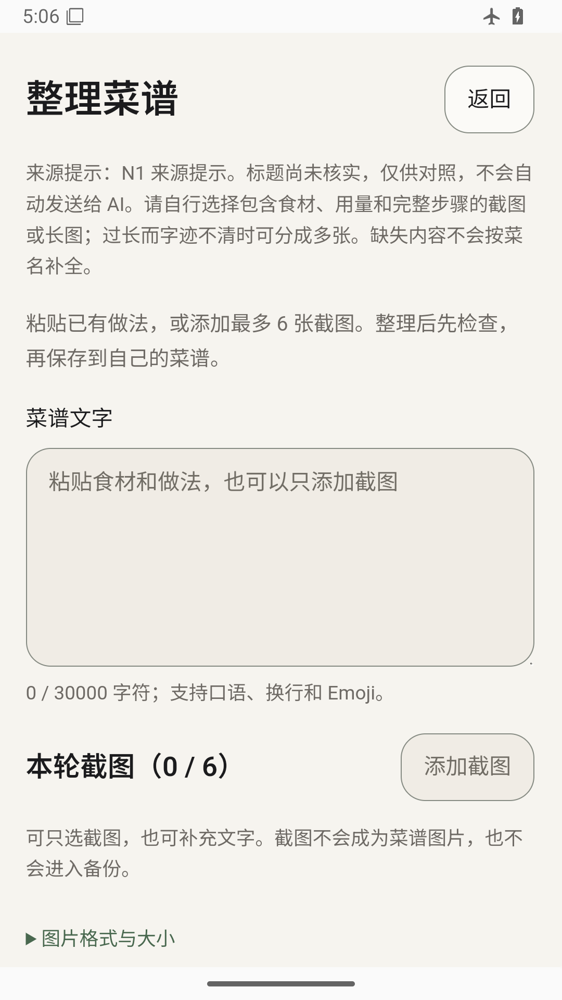
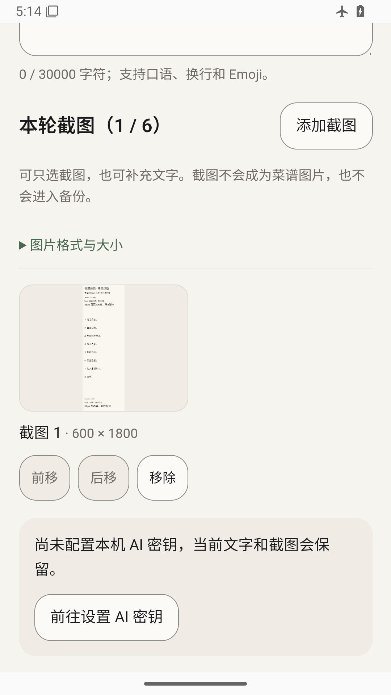
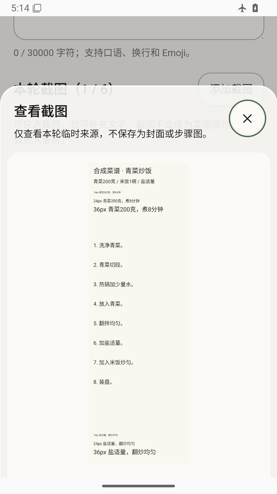
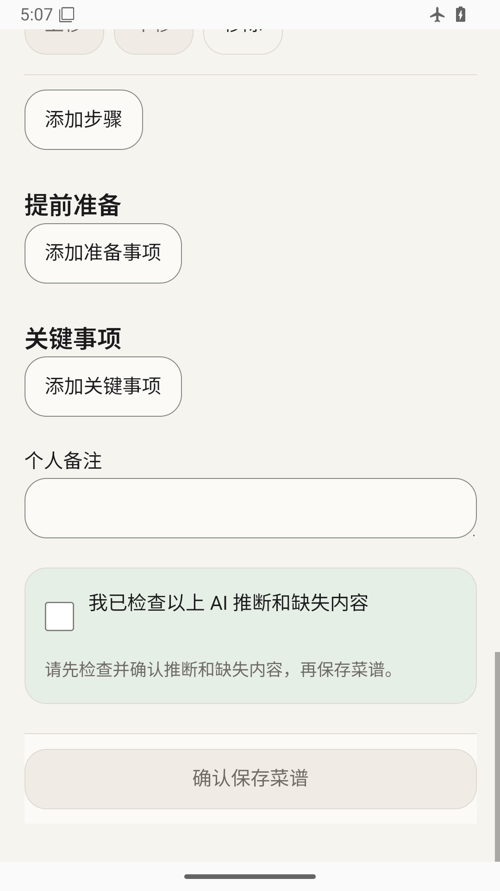

# XHS-R2-N1 — Android 长图验证送审

2026-11-03 · **READY_FOR_INDEPENDENT_REVIEW**。这是限定验证交付，不是新的产品冻结或发布结论。

## 固定输入与修改范围

- 冻结业务源码：`c2c55d21c8328e6f78aa7f738bf9d1eba9f1423d`。
- 原浏览器脚本：`cb4d5e864e6d4f51febcc7ac9acbf7c9c1bf6f85`；原证据：`28b1a6bf0ceff6ab161dcff85d076733785b4a87`。
- XHS-R2 的 ChatGPT 限定验收已[登记](../xhs-r2-20261103/INDEPENDENT_ACCEPTANCE.md)，不覆盖原 NOTES、失败或 NOT_RUN。
- 本轮最终被测测试源码：[`b38f82d7f005f28c3af3ef0fbd934b8d162f0b08`](https://github.com/cc7279694-debug/menu/commit/b38f82d7f005f28c3af3ef0fbd934b8d162f0b08)。产品源码与冻结输入相同。
- 相比原送审证据，仅新增 `XhsR2LongImageInstrumentedTest.java`、扩展 `AiImeBackInstrumentedTest.java`，以及文档/生成证据；不修改生产源码、依赖或版本。
- [最终回执](FINAL_RECEIPT.json)记录最终测试源码 blob、实际测试 APK 哈希和唯一测试数。[证据大小与 SHA-256](EVIDENCE_SHA256.json)可逐文件复核。之后的交付提交只增加文档/证据，不改变被测代码。
- evidence目录局部 `.gitattributes` 保留原始字节，避免Windows自动换行转换使GitHub文件哈希与回执不符；提交前同时回读Git暂存blob逐项核对。
- 手写文档的diff whitespace检查通过；原始构建/测试日志自带CRLF、尾空格和末尾空行，因此全目录 `git diff --check` 会报日志格式提示，原件不为消除提示而改写。这不是新增源码格式失败或被跳过的产品测试。

原[内存阻塞 checkpoint](CHECKPOINT.md)及[环境记录](environment.json)保持原样；它们描述前次停止，不代表本次结果。

## 环境与隔离

重新检查后，新 AVD 启动前实际空闲 **5.996 GiB**，高于既有 4 GiB 门槛。独立 AVD `Recipio_XHS_R2_N1_API36`，`emulator-5686`，Android 16 / API36 / ranchu，2560 MiB、2 CPU，1080×1920。WebView 为 `com.google.android.webview 133.0.6943.137`。

只读使用已有 API36 镜像与工具，不安装新 SDK；AVD 数据单独放在 `E:/CODEX/Tools/recipio-xhs-r2-n1-20261103/avd`。没有停止、复用其他项目的设备、进程或数据。测试前启用飞行模式、关闭 Wi-Fi/移动数据；结束仍为飞行模式。未连接或操作小米14。

仅在此全新合成数据 AVD 安装 debug 测试应用和 instrumentation，未安装正式签名 APK。结束已确认归属并关闭本轮 AVD，保留其数据目录；[关闭回执](evidence/owned-avd-stop.txt)。

**原始系统异常保留：** 初次启动时出现3条系统启动 ANR：Google Play services persistent、Gboard、Google Play services，均在应用测试开始之前。[测试前日志](evidence/before-tests-system-events.txt)与[结束日志](evidence/after-manual-system-events.txt)保留同3条；未观察到 RECIPIO ANR/崩溃条目。这不等于设备稳定性或所有生命周期情形已验收，未断言具体根因。

## 构建与实际运行

| 项目 | 本轮结果 | 证据 / 范围 |
| --- | --- | --- |
| Web 构建与 Capacitor sync | PASS | `VITE_RECIPIO_VERSION=0.11.1-personal.1 npm.cmd run sync:android`；[原日志](evidence/web-sync.txt)含生产隔离检查 |
| Debug app + AndroidTest 构建 | PASS | JDK21、SDK36、offline、single worker；[应用任务日志](evidence/gradle-build-app.txt)；[最终 AndroidTest 重建](evidence/gradle-tests-final.txt) |
| Android 新图像测试 | 3 PASS | 实际 codec 处理/原像素裁片、真实大小与像素上限、顺序/移除/重选/会话清理 |
| Android 新 UI 流程 | 2 PASS | 真实系统 Picker/实际图片预览、IME Back/取消；多图/显式 Fake HTTP/人工审核/SQLite 保存与清理 |
| Android 既有回归 | 7 PASS | AiTemporaryImages 6项；`selectedTempImages_surviveImeBack` 1项 |
| **Android 合计** | **12项唯一测试 PASS** | [取消1](evidence/native-ui-cancel-final.txt)、[保存1](evidence/native-ui-save-final.txt)、[回归10](evidence/native-regression-final.txt)；全部来自同一最终 instrumentation APK，不累计重跑次数 |
| JS/TS 相关回归 | **51项 / 3文件 PASS** | link-import/service、ai/service、ai/save；[日志](evidence/js-save-recovery.txt)，覆盖错误恢复/显式AI/保存失败及 UUID 恢复等服务边界 |
| 独立 Typecheck / Lint / JVM 单测 / 全仓历史 connected | NOT_RUN | 本轮生产 TS/Java 未变，只补 androidTest；原 XHS-R2 的444/25/27等历史数字不作为本轮新结果 |

复现入口：[有归属门禁的运行器](evidence/run_native.py)，类名及命令见各运行 JSON。构建使用：

```text
:app:assembleDebug :app:assembleDebugAndroidTest --offline --no-daemon --max-workers=1
:app:assembleDebugAndroidTest --offline --no-daemon --max-workers=1
npx vitest run src/native/link-import/service.test.ts src/native/ai/service.test.ts src/native/ai/save.test.ts --pool=threads --maxWorkers=1 --no-file-parallelism
```

原失败不隐藏：

1. [首次无模块限定 Gradle 构建](evidence/gradle-build-1.txt)额外触发 Cordova 插件自身 AndroidTest 的 Kotlin 重复类。改用明确的 `:app:` 构建，保留应用正常 duplicate-class 检查，不改依赖、不排除应用检查。[依赖诊断](evidence/kotlin-dependency-insight.txt)。
2. [首次取消流程失败](evidence/native-ui-cancel-1.txt)：测试在懒加载 URL 输入页渲染前赋值，使“读取网页”仍禁用。只在测试中等待实际 URL input 出现，之后最终两条流程通过；没有生产 UI 修补。
3. 自动截图已等待 WebView 绘制，但[输入截图仍在上方](evidence/ui/harness-scroll-limitation.png)，缩略图不完全可见；不能以此声称可视预览通过。另在相同已安装应用中经真实系统 Picker 选择同一生成长图，使用已有预览 Sheet，确认尺寸/屏内位置后用原生 screencap 补到下列实际图片。未修改 CSS 或拼造截图。
4. Vite config loader 的既有 CommonJS/ESM 提示保留。原5项 Lint 警告沿用历史记录，本轮不宣称重新跑过 Lint。

## 处理前后参数与清晰度

以下为 Android **实际输出**，不是静态公式预测。生成原图及 JPEG、顶部/底部裁片均可在[geometry](evidence/geometry)查看；完整大小/哈希在[参数 JSON](evidence/geometry/image-processing.json)。可读性由 Codex 查看原像素裁片判断，独立 ChatGPT 仍需复核；不是 OCR 或模型准确率分数。

| 合成样本 | 原图 PNG | 处理后 JPEG | 14 / 24 / 36px 测试字观察 |
| --- | --- | --- | --- |
| 普通截图 | 1080×1440，126,794 B | 1080×1440，72,063 B | 顶部/底部仍可辨认，轻微JPEG变化 |
| 长图 | 600×1800，121,989 B | 600×1800，68,644 B | 顶部/底部仍可辨认，无几何缩小 |
| 高长图 | 1080×7200，168,286 B | **307×2048，15,519 B** | **14px不能可靠辨认；24px明显退化；36px仍可识别但很小** |

**高长图清晰度限制成立，不能登记为全尺寸长图 PASS。** 原最长边2048与解码采样策略使其缩小，测试字高按比例约3.98/6.83/10.24px（估算，不是OCR测量）。这可能影响之后AI辨认，但本轮0真实AI，未测模型。没有改 codec、提高安全上限或宣称已修复此限制。现有流程允许用户自行把密集长图分成几张截图再选择；这是使用建议，不是新增切图功能。

实际600长图预览（用于证明原生选择及显示，清晰度判断以上述原像素文件为准）：






补拍使用只连接此 AVD debug WebView 的本地 CDP，定位已有控制并滚动到图片，原生 Picker 选择 `N1_GENERATED_600.png`，未触发AI或保存。尺寸/实际可见区域记录在[回执](evidence/manual-preview-geometry.json)。截图未编辑。放弃后[真实cache目录为空](evidence/temp-cleanup-after-manual.txt)。这段人工受控验证与上表12项自动化计数分开，不另加测试数。

## 原生边界与保存保护

- 实际 ACTION_OPEN_DOCUMENT 打开、取消不会产生图片或Provider请求；600长图选择后 naturalHeight=1800，7200长图处理后 naturalHeight=2048；UI可前移、删除及重新选择。
- 真实Gboard/IME首次Back关闭键盘，图片/来源提示保留，不出现放弃Dialog；本轮仅覆盖相关场景，**没有重跑完整八场景**。
- 8001×4000 = 32,004,000像素合法PNG、15MiB+1字节流均实际拒绝 `image_too_large`，不注册图片、不残留来源片段；[实际回执](evidence/limits/limit-rejections.json)。没有放宽上限。
- 原生按请求顺序读取经像素颜色断言；移除只影响指定图片，重新选择产生新ID，放弃只删除所属会话；[顺序/清理回执](evidence/ordering/ordering-and-cleanup.json)。既有临时文件、JPEG、符号链接等6项原生回归也通过。
- 网页读取仅由测试适配器返回合成“仅标题”页；后续Picker/Native解码/本地临时文件/JS审核/SQLite保存为真实安装路径。**这不是实际小红书网络验证。**
- Provider为测试进程注入的Fake HTTP，使用隔离、不可用于真实账号的随机测试凭据。选择图片时0请求，主动点击后恰好1次Fake请求；请求体断言不含来源标题、xhslink.cn或合成分享参数。没有真实Cookie/Token、私人正文或真实密钥。
- Fake输出只是一条合成步骤“先焯水”，不宣称识别了图中的8步。未勾选审核时save禁用，提交form也不保存；明确勾选后保存普通Recipe，验证详情标题与步骤；遇重跑同名时明确选择“仍然新建”，没有清库掩盖失败。
- 保存/放弃后实际 `cache/ai-import` 无会话文件。Fake输出coverPath和step imagePath为null，按冻结保存结构不引入来源截图；本轮未重新导出Backup验证媒体集合，不能冒充新增Native备份证据。成功保存路径原生通过；保存故障/UUID恢复由当前51项JS服务测试保护，**本轮没有新增Native数据库故障注入**。

## 安全与保留项

对冻结源码的 `src/`、`native/`、`android/app/src/main/`、build.gradle及gradle.properties差异为空；网络SSRF/全DNS地址/Fake-IP拒绝/DNS pin/TLS/HTTPS、Key/Provider、SQLite4、Preview7、Backup2、三主题和Logo均未修改。没有真实小红书请求、真实AI、手机操作、个人数据清理、main合并或发布。未接触正式签名身份、私钥或密码；仅SDK常规debug测试签名，非正式候选。

唯一既有签名V28重新只读计算SHA仍为：

```text
E:/CODEX/RECIPIO-Signing/recipio-personal-release-v28/recipio-personal-v28.apk
15,194,675 bytes
52dfed4ef23afb5aa0dc6fb2b6089921af240993627aec9479ff69ea3d94b59b
```

本轮本地 debug app / instrumentation 只用于专属模拟器，路径/大小/SHA在最终回执；没有制作新的正式签名候选，不向用户交付安装升级。

继续 NOT_RUN / UNKNOWN：

- 小米14、OEM、TalkBack、真实手机系统字号/性能/电话等中断场景。
- 真实XHS短链/登录验证码/公开状态形态，原手机失败根因；未获本轮联网授权，不猜实际页面内容。
- 真实AI及真实来源菜谱识别准确率；未请求或读取用户Key。
- 真实私人长图、其他字体/密度/比例，以及所有长图都清晰的保证。
- 全历史connected、完整8项IME Back、新Native保存失败注入、完整备份/恢复和签名升级，本轮没有重跑。
- 三主题原浏览器证据保留，本轮Android截图为默认Warm Ivory，不虚称三套原生像素均复验。

## 交付与停止点

只提交androidTest和非敏感合成证据至 `verification/recipio-xhs-r2-n1`，保留原未跟踪 `android/.idea/`。XHS-R2既有接受状态、G4整体PENDING、R1延期均不改变。当前结论是本轮受控原生路径可复验、**高长图小字存在已复现限制**，等待ChatGPT独立验收；不自动修codec或进入新版签名。
