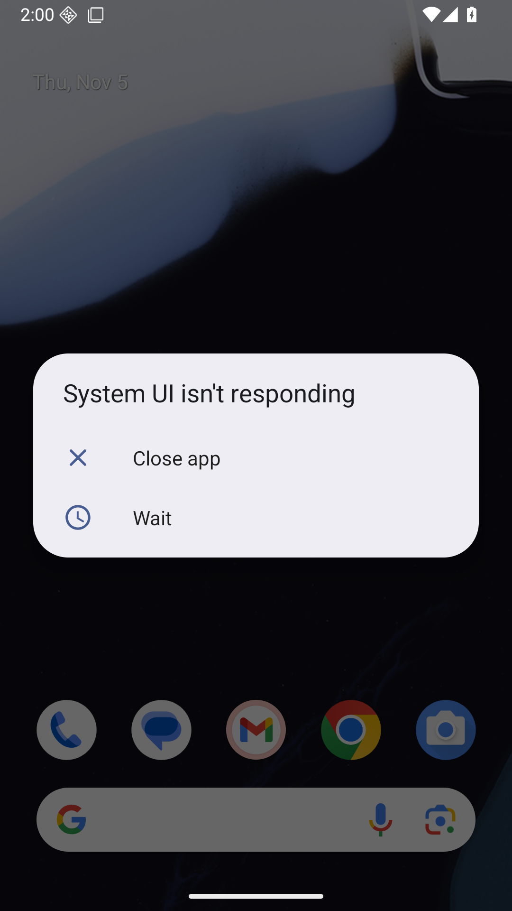

# XHS-R2-N2 — 2026-11-05 定向续跑结果

**BLOCKED — VERIFIED_DEFECT（ENV_SYSTEM_STARTUP_ANR）**。

此状态指**已确认的模拟器系统启动异常**，不是已经确认的RECIPIO生产缺陷。内存准入已通过，不能继续把本次失败登记为内存不足。尚未安装App或执行原生测试，未产生实际分段图或清晰度结论。

## 固定输入和本轮范围

- 分支：`feat/recipio-xhs-r2-n2-long-image`。
- 原业务/测试源码：`51a2d92d1417cc99bbba9547bcbb2497b8757949`，本轮没有生产或测试源码变化。
- 续跑起点：`0daf4c04c7b653ba5b776ea24fb4dd6fda06337a`；原[checkpoint](CHECKPOINT.md)、[报告](REVIEW.md)、[回执](RECEIPT.json)与所有历史失败保留，不覆盖。
- 按用户提供的 `CODEX_RECIPIO_XHS_R2_N2_FAST_RESUME.md` 执行：复用已有APK/新专属AVD，先通过资源和系统健康门禁，再执行6项新原生测试。未重复开发或重跑已有55JS/208JVM等。
- [本轮机器回执](resume-20261105/RECEIPT.json)和[逐文件字节/SHA-256](resume-20261105/EVIDENCE_SHA256.json)。仅上传新AVD的系统画面与非敏感日志，没有私人媒体、密钥、菜谱或备份。

## 实际过程与门禁

| 检查 / 动作 | 结果 |
| --- | --- |
| 分支/HEAD/源码blob与跟踪工作区 | PASS；起点0daf4c04，业务/测试仍51a2d92，保留原未跟踪 `android/.idea/` |
| 固定测试APK / instrumentation / 正式V28 SHA | PASS，全部精确匹配输入；没有重建或重签 |
| 启动前内存与端口 | **PASS：5.437GiB≥4GiB**，5690/5691空闲 |
| 专属AVD启动 | 仅1次；`Recipio_XHS_R2_N2_API36` / `emulator-5690` / API36 / 2560MiB / 2CPU / no-snapshot / no-audio / hidden |
| Android boot_completed | 182.9秒后为1；这本身不是系统健康PASS |
| 首次系统健康检查 | **FAIL**：实际SystemUI无响应Dialog；启动阶段7条系统ANR |
| 单次受控恢复 | 仅点击系统“Wait”1次，没有Close app、重启、清数据或重复启动；之后新增1条Gboard ANR |
| 复核结果 | **FAIL：共8条系统ANR、0条am_crash**；Launcher恢复焦点不能抵消新增ANR |
| App安装 / 原生测试 / 实际段图 | **NOT_RUN**；安装前系统门禁未通过，pm列表确认无RECIPIO包 |
| 结束 | 只关闭本轮AVD，保留数据目录；正式V28哈希不变，其他项目/手机操作0 |

证据入口：

- [资源准入](resume-20261105/evidence/admission-20261105.json)、[启动完成记录](resume-20261105/evidence/boot-20261105.json)。
- [首轮7条原始系统ANR事件](resume-20261105/evidence/startup-anr-events-20261105.txt)、[当时系统窗口](resume-20261105/evidence/startup-focus-20261105.txt)、[系统Dialog原始UI结构](resume-20261105/evidence/startup-anr-ui-20261105.xml)。
- [一次Wait复核回执](resume-20261105/evidence/startup-recovery-20261105.json)、[之后8条原始事件](resume-20261105/evidence/recovery-anr-events-20261105.txt)、[之后窗口](resume-20261105/evidence/startup-recovery-focus-20261105.txt)。
- [安装前包列表](resume-20261105/evidence/pre-install-packages-20261105.txt)、[专属AVD停止回执](resume-20261105/evidence/owned-avd-stop-20261105.txt)。

这是**系统故障截图**，不是RECIPIO界面或分段图片：



系统启动ANR涉及Google Play services、SystemUI、Gboard及系统组件；Wait之后新增的是Gboard进程启动ANR。具体根因仍UNKNOWN，不能仅凭这些事件归因为SDK缺陷、内存不足或RECIPIO代码。原始完整日志留在本机独立Tools目录，仓库保留与门禁有关的原始事件行及窗口/截图，未改写失败内容。

## 产品验证结果

以下全部 **NOT_RUN / NOT_VERIFIED**：

- `XhsR2SegmentedImageInstrumentedTest` 4项。
- `xhsR2NativeLongPickerCancelKeepsExistingImage` 1项。
- `xhsR2NativeLongSegmentsKeepOrderUntilExplicitReviewAndSave` 1项。
- 4段真实JPEG、逐段尺寸/大小/SHA、顶部/中部/尾部及边界14px/24px裁片、实际清晰度。
- 实际Picker/预览/审核、原生取消/保存清理、普通截图/IME必要回归。
- 飞行模式App测试、补充JS和module graph隔离：未进入核心原生证据完成后的阶段。

**本轮原生测试计数为0，不能把系统检查当成6项产品测试通过或失败。** 没有新原生分段图片，不提供预制对照图。N1的1080×7200小字清晰度FAIL仍保留；N2改善目标仍未实测。

原55项定向JS/TS、208项JVM、Typecheck、Lint（5项既有警告）、Web/sync与Debug/Test构建是51a2d92对应的历史提交方证据，保持有效但本轮未重跑，也不替代上述NOT_RUN。

## 数据、安全及交接

没有源码修复提交，未修改SQLite4/Preview7/Backup2、Provider/Key、Native网络安全、主题/Logo或权限。没有安装正式V28、访问签名私钥/密码、调用真实AI/XHS、连接小米14或触碰个人数据。

两份既有测试APK保持：

```text
test-app-debug.apk — 17,493,631 bytes
03eca4b65f10e2698f2ea69378257699ccd815a0be8ddfa82cb96b079e502019
test-instrumentation.apk — 843,225 bytes
fec06806fbb02d1bf51443e97a173e8c4acb7c0785db7e3d78d447dc30ce8bab
```

唯一正式V28仍为15,194,675字节，SHA `52dfed4ef23afb5aa0dc6fb2b6089921af240993627aec9479ff69ea3d94b59b`。

本轮只新增文档及系统环境证据，普通推送当前分支，不合并main、不发布。停止进一步启动/重试，等待ChatGPT审查本环境故障证据并决定后续受控环境处理范围。后续仍继承原checkpoint的固定源码和APK；不能通过删数据、更换SDK、关其他任务或放宽健康门禁来获取绿灯。
